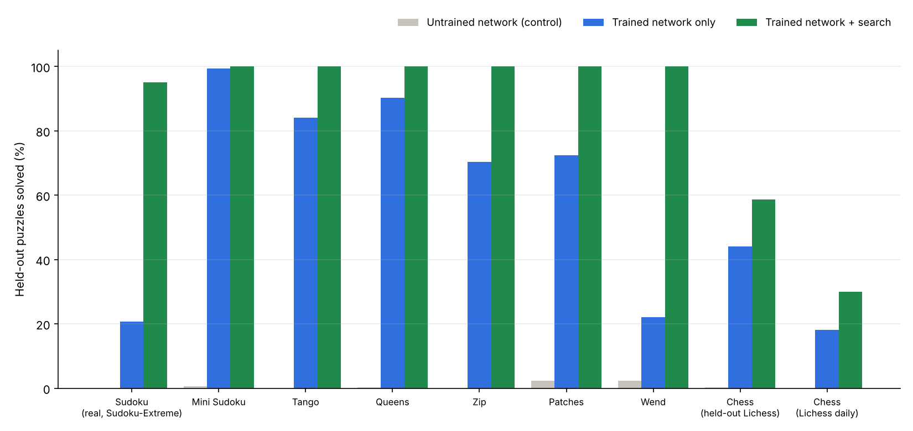

# Puzzle Arena

Neural networks **trained from scratch on a 4-core CPU** for nine games:
Sudoku, Mini Sudoku, Tango, Queens, Zip, Patches, Wend, chess puzzles, checkers.
There is also a Pinpoint experiment. No pretrained weights, no pretrained
language model and no external solver are used. Every reported "solved" answer
is checked by an independent rule verifier.



Screenshots of every game and a 2-minute screen recording of the real UI
([arena-demo.mp4](evidence/arena/arena-demo.mp4)) are in
[evidence/arena](evidence/arena/README.md).

## What "real" means here

| Game | Puzzles used for training and testing |
|---|---|
| Sudoku | **Real**: the public [Sudoku-Extreme](https://huggingface.co/datasets/sapientinc/sudoku-extreme) dataset (community puzzles, many among the hardest known). Trained on 383,200 train-split puzzles; tested on 300 puzzles from the separate test split. |
| Chess | **Real**: the [Lichess puzzle database](https://database.lichess.org/#puzzles) (CC0). Training and test puzzles come from **different source games**. A second test set holds all **297 Lichess daily puzzles**, none of which were used in training. |
| Mini Sudoku, Tango, Queens, Zip, Patches, Wend | **Generated by this code** with the official LinkedIn rules, each with **exactly one solution** (checked by an exhaustive solver). LinkedIn's daily puzzles are not public data and were not used. Test puzzles use different seeds and are deduplicated against training. |
| Checkers | Games. The network learned only from self-play and was evaluated against engines it never trained against. |
| Pinpoint | Word vectors trained on WikiText-103 (Wikipedia text). Tested on 40 handwritten Pinpoint-style puzzles and 300 WordNet categories. These are **not** real LinkedIn puzzles. |

Wend uses a 12,000-word common-English dictionary (ENABLE words ranked by
OpenSubtitles frequency), so real Wend puzzles with rarer words can fail.

## Three ways to solve, plus controls

- **Network only**: the network chooses every move. Rules only block illegal
  moves, and there is no backtracking. (Sudoku, Tango and Queens also report
  a stricter *one pass, no rules* score.)
- **Network + search**: depth-first backtracking whose choices are ordered by
  the network. For chess this is alpha-beta search with network move ordering.
- **Untrained network**: the same architecture with random weights. This shows
  what training added.
- **Classical solver**: the same search with no network. For these puzzle
  sizes it is the fastest exact method, and this README says so wherever it
  wins.

## Results on held-out puzzles

300 puzzles per game unless stated (Wilson 95% intervals are in each `report.json`).

| Game | Network only | Untrained network | Network + search | Classical solver | Search states: trained / untrained ordering |
|---|---:|---:|---:|---:|---:|
| Sudoku (real, Sudoku-Extreme) | 20.7% | 0.0% | 95.0%* | 100% | 687 / 544 |
| Mini Sudoku | 99.3% | 0.7% | 100% | 100% | 23 / 23 |
| Tango | 84.0% | 0.0% | 100% | 100% | 35 / 64 |
| Queens | 90.3% | 0.3% | 100% | 100% | 14 / 66 |
| Zip | 70.3% | 0.0% | 100% | 100% | 53 / 117 |
| Patches | 72.3% | 2.3% | 100% | 100% | 9 / 14 |
| Wend | 22.0% | 2.3% | 100% | 100% | 6.6 / 6.9 |
| Chess, held-out Lichess puzzles | 44.0% | 0.3% | 58.7% | 52.3% (search without network) | — |
| Chess, Lichess daily puzzles (297) | 18.2% | 0.0% | 30.0% | 22.6% (search without network) | — |

\* Sudoku search uses a 2,000-state budget; 15 hard puzzles ran out of budget.

What this shows:

- **Training clearly works.** Untrained networks solve 0–2% on their own;
  trained ones solve 70–99% of Mini Sudoku, Tango, Queens, Zip and Patches
  with no backtracking.
- **Network-guided search reaches 100%** on every LinkedIn-style game. The
  network halves the search on Tango and Zip and cuts it about 5x on Queens.
- **Real Sudoku-Extreme is hard for a small network.** Without search it
  solves 80% of the easy puzzles (rating 0), 17% of the medium ones (rating
  1–20) and 2% of the hardest (rating >20). Here the network does **not**
  help search: random ordering explored fewer states, and the classical solver
  is 100% and much faster. Published methods need far more compute than one
  CPU for two hours.
- **Chess:** the network alone finds the whole winning line in 44% of
  held-out puzzles (79% of puzzles rated below 1200, 6% of those above 2000).
  With search it beats the same search without the network (59% vs 52%).
- **Classical solvers are faster** for every grid puzzle here (milliseconds).
  The networks are a learning result, not a speed improvement.

## Chess and checkers games

| Match | Win | Draw | Loss |
|---|---:|---:|---:|
| Chess: network only vs random mover (20 games) | 15 | 5 | 0 |
| Chess: network only vs 1-ply material engine (20) | 0 | 10 | 10 |
| Chess: network + search vs same search without network (10) | 0 | 5 | 5 |
| Checkers: network (depth 1) vs random mover (40) | 40 | 0 | 0 |
| Checkers: network (depth 1) vs material engine (depth 1) (40) | 40 | 0 | 0 |
| Checkers: network (depth 2) vs material engine (depth 2) (40) | 15 | 18 | 7 |
| Checkers: network (depth 2) vs material engine (depth 4) (40) | 4 | 20 | 16 |
| Checkers: **untrained** network (depth 2) vs material engine (depth 2) (40) | 0 | 0 | 40 |

The chess network learned from tactical puzzle positions, so it is a puzzle
solver, not a strong game player: in normal games its preferences make the
search slightly worse. The checkers network was trained only by self-play.
It beats a material-counting engine at equal search depth (60% score) but
loses to one that searches twice as deep.

## Pinpoint

| Test set | Answer is the top guess after 5 clues | Answer in the top 5 | Random guess |
|---|---:|---:|---:|
| 40 handwritten Pinpoint-style puzzles | 5% | 33–38% | 0% |
| 300 WordNet categories | 3–5% | 10–14% | 0% |

This is **weak**. Word vectors trained here put "guitar" near "piano", but they
rarely name the category ("instrument"). Real Pinpoint needs the broad world
knowledge of a large pretrained language model, which cannot be trained from
scratch on this machine. A small category head trained on WordNet (with every
test answer excluded) did not reliably help.

## Honest notes

- **Two failed runs are recorded, not hidden:**
  - *Checkers v1* used Monte Carlo targets with 15% random moves. It lost to a
    random mover at search depth 2, so it was replaced by TD(λ) self-play (v2).
  - *Wend v2* (a wider network trained 2.5× longer) overfit: 99% training
    accuracy, 69% held-out. It solved fewer puzzles without search (15.7% vs
    22.0%; [report](benchmarks/arena/results/wend-v2-overfit/report.md)). The
    original Wend model ships. Both were scored on the same test set, so this
    choice was made after seeing test results.
- The validation numbers in the puzzle `metrics.jsonl` files were logged on
  the held-out test puzzles. They were never used for checkpoint selection or
  early stopping: every model is simply its final step.
- Chess `train_seconds` covers only the resumed part of training (the run was
  restarted from its step-500 checkpoint with a shorter schedule). The Sudoku
  run was likewise resumed from step 250.
- CPU only (no GPU). Training shared four cores between several jobs, so the
  wall-clock times are not clean speed measurements.

## Run it

```bash
python -m pip install -e '.[games]'
python -m unittest discover -s tests -v                      # 27 tests: rules, verifiers, generators, solvers, games
arena ui --artifacts artifacts/arena --port 7861             # browser UI for every game
arena solve --run artifacts/arena/queens --mode neural \
  --puzzle "$(head -n1 benchmarks/arena/queens/test.jsonl)"
```

Reproduce training and benchmarks:

```bash
python scripts/build_datasets.py --out data                  # unique-solution train/test sets
arena train --data data/tango/train.jsonl --val data/tango/test.jsonl --run runs/tango --steps 2000 --width 64 --blocks 6
arena train --data sudoku-extreme/train.csv --csv-step 10 --run runs/sudoku --steps 2500 --width 128 --blocks 12
python scripts/prepare_chess.py lichess_db_puzzle.csv.zst chess-data
python -m arena.games.train_chess --data chess-data/train.npz --run runs/chess --steps 4000
arena bench --run artifacts/arena/tango --test benchmarks/arena/tango/test.jsonl --output runs/bench-tango
python scripts/bench_games.py chess-puzzles | chess-games | checkers | pinpoint
python scripts/arena_summary.py                              # rebuilds the chart above
```

Training resumes with `--resume`. Raw per-puzzle records (every answer, state
count and time) are in `benchmarks/arena/results/*/records.jsonl`.

## Layout

```
arena/puzzles/   rules, verifiers and generators: sudoku, tango, queens, zip, patches, wend
arena/search.py  backtracking, greedy network play, one-shot mode
arena/nets.py    GridNet: convolution plus row/column/region mixing
arena/train.py   resumable training (bf16 autocast on CPU)
arena/games/     chess (policy net + alpha-beta), checkers (self-play value net), pinpoint
arena/ui.py      local web UI (standard library HTTP server)
artifacts/arena/ trained weights, manifests and training curves for every game
benchmarks/arena/ held-out test sets and results
```

Data licences: Sudoku-Extreme (Hugging Face dataset card), Lichess puzzles
(CC0), WikiText-103 (CC BY-SA 3.0), ENABLE word list (public domain),
FrequencyWords (MIT), WordNet (WordNet licence).
