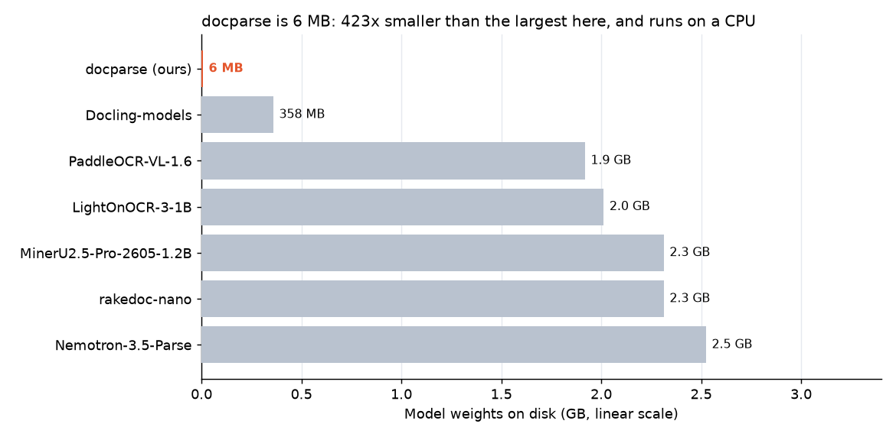
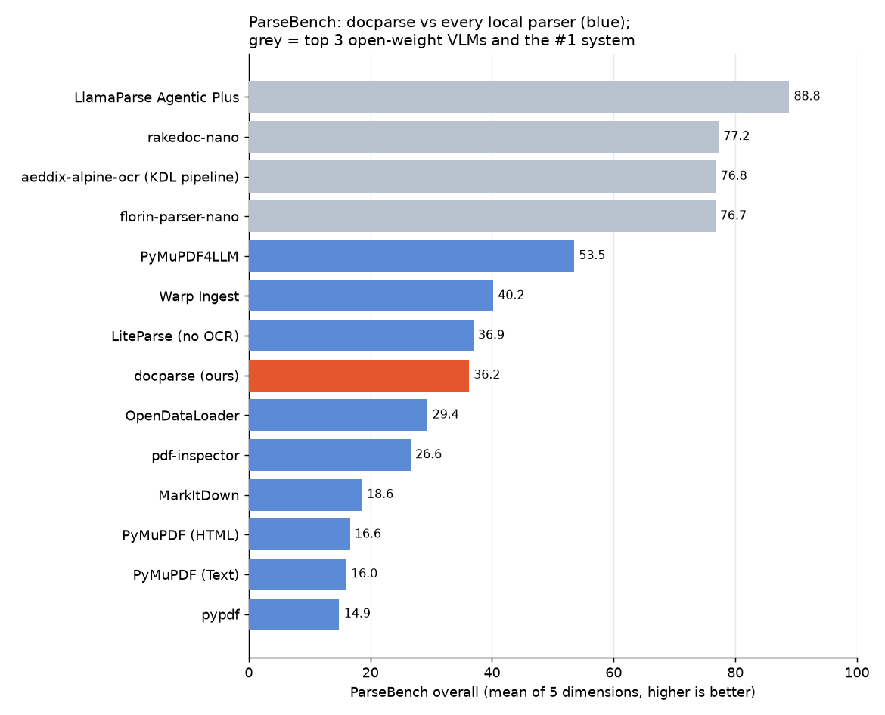
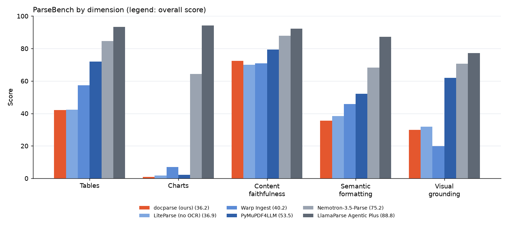
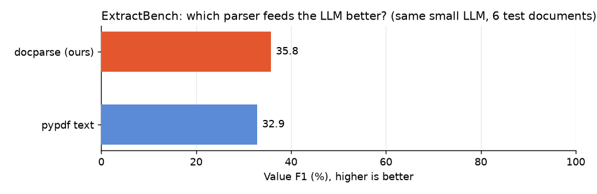

# docparse: a very small document parser

**6 MB model, CPU only.** ParseBench 36.2, just below LiteParse (36.9) among local parsers,
with a network 60x to 420x smaller than the open-weight document models.

- **Try it:** [huggingface.co/spaces/Kedhareswer/docparse](https://huggingface.co/spaces/Kedhareswer/docparse) (drop a PDF, image, Word, Excel, CSV or PowerPoint file)
- **Weights and code:** [huggingface.co/Kedhareswer/docparse](https://huggingface.co/Kedhareswer/docparse): `artifacts/docparse/ocr.pt` (6.0 MB), the `docparse` package, benchmark reports and tests
- **Source:** [github.com/Kedhareswer/ML-AI](https://github.com/Kedhareswer/ML-AI) (`reasoning_harness/`)

`docparse` extracts **everything** from a document (text, headings, paragraphs,
lists, tables, sheets, formulas, headers/footers, metadata and figure positions)
and returns it as JSON, Markdown or plain text, with reading order preserved.

| Input | How it is read | Exact? |
|---|---|---|
| PDF with a text layer | Words and fonts from the PDF; layout analysis groups them into headings, paragraphs, lists, columns and tables | Text is exact |
| Scanned PDF pages (no text layer) | Rendered at 200 dpi, then the OCR pipeline below | OCR |
| Images: PNG, JPG, TIFF (multi-page), BMP, WEBP, GIF | OCR pipeline | OCR |
| Word `.docx` | Document structure: styles → headings/lists, tables (merged cells), text boxes, headers/footers, properties | Exact |
| Excel `.xlsx` | Every sheet: values, formulas, merged ranges, dates, separate tables split on empty rows/columns | Exact |
| CSV / TSV | Delimiter and encoding sniffed | Exact |
| `.doc`, `.rtf`, `.odt`, `.xls`, `.ods`, `.ppt`, `.pptx`, `.odp` | Converted with LibreOffice (if installed), then parsed as above | Exact |

The design choice: **a model is only used where one is needed.** Born-digital
files already contain their text; reading their structure is exact and much
faster than any network. The neural network reads pixels: images, scans and
(optionally, `--ocr-images`) pictures embedded inside documents.

## How small it is

docparse's only network is **6 MB** (1.48 M parameters) and runs on a CPU. Open-weight
document models are 60x to 420x larger and want a GPU. (Local parsers such as PyMuPDF4LLM
use no model at all and cannot read scans or images.) Accuracy against other parsers is in
[ParseBench](#parsebench-llamaindex) and [ExtractBench](#extractbench-llamaindex-small-local-check) below.



Sizes are the weight files in each model's Hugging Face repo (`benchmarks/parsebench/model_sizes.json`).
All charts are drawn by `scripts/plot_docparse.py` from the files in `benchmarks/`.

## The model

A CRNN line recognizer trained **from scratch** (no pretrained weights) on a
4-core CPU:

- **1,484,357 parameters, 6.0 MB** (`artifacts/docparse/ocr.pt`): 6 convolution
  layers, a 2-layer bidirectional LSTM and CTC decoding.
- Input: a grayscale text line, 32 px high, any width. Output: the text plus a
  confidence (mean probability of the emitted characters).
- Characters: printable ASCII plus `• € £ ° ©`. Typographic quotes, dashes and
  accented letters are folded to ASCII (`é` → `e`).
- Training: 480,000 synthetic lines (4 rounds of 120,000 freshly rendered
  lines), 27 fonts (DejaVu, Liberation, FreeFont, Inter, JetBrains Mono),
  text from app reviews and medical abstracts in this repository, plus
  generated numbers, prices, dates, emails, URLs, IDs and list items. Lines are
  degraded like scans and screenshots: blur, low resolution, noise, JPEG,
  rotation, uneven light, inverted colours and table-rule remnants. Training
  took 80 minutes.

Everything around the network is classical image processing (numpy only):
adaptive binarization (dark-on-light and light-on-dark), speck removal,
deskew, ruled-table detection from long horizontal/vertical strokes, frame
and outline removal, recursive XY-cut for columns and lines, then grouping
lines into headings (by x-height), paragraphs (by line spacing), list items,
and borderless tables (rows whose gaps line up).

## Results

All numbers are from `docparse bench` (`benchmarks/docparse/report.json`).
CER = character error rate (edit distance / reference length).

**1. Single lines.** Test fonts **Carlito and Caladea were never used in
training** (they are metric clones of Calibri and Cambria, the Office
defaults), and the test sentences come from a separate corpus.

| Test set | Lines | CER | Word error | Lines exactly right |
|---|---:|---:|---:|---:|
| Held-out fonts, clean | 2,000 | **0.27%** | 2.3% | 93.3% |
| Held-out fonts, degraded | 2,000 | **0.93%** | 6.0% | 84.8% |
| Training fonts, unseen text, degraded | 2,000 | 0.24% | 1.2% | 95.6% |
| Untrained network (same architecture), degraded | 500 | 99.7% | 99.8% | 0% |

About 3 ms per line on CPU.

**2. Synthetic A4 pages** (held-out fonts and text; titles, section headings,
paragraphs, bullet lists, ruled tables, key/value tables, two-column sections).
"Scanned" pages are rotated up to ±2°, blurred, noised and JPEG-compressed.

| | Clean (40 pages) | Scanned (40 pages) |
|---|---:|---:|
| Page CER, in reading order (mean / median) | 0.32% / 0.00% | 1.65% / 0.19% |
| Word F1 (order-free) | 98.9% | 97.7% |
| Headings found | 86.7% | 85.7% |
| Tables found with the right rows × columns | 100% | 100% |
| Table cells exactly right | 98.5% | 90.2% |
| Seconds per page (CPU) | 0.9 | 1.3 |

A few hard pages pull the scanned mean up; the median page is almost perfect.
Missed headings are mostly short numbered section titles ("1. Results") read
as list items or paragraphs: headings are detected by letter size, not by
boldness.

**3. Real pages from this repository.** 40 pages of the three PDFs in this
repo (two Jupyter notebook exports and a slide deck) were rendered to
150 dpi images and read **from pixels only**. Each PDF's own text layer is the
reference.

| PDF | Pages | Median CER (reading order) | Median word F1 |
|---|---:|---:|---:|
| Customer Behavior Analysis (notebook) | 15 | 0.7% | 92.5% |
| Credit Card Fraud Detection (notebook) | 11 | 2.3% | 94.8% |
| PPT.pdf (slides with graphics) | 14 | 32.3% | 82.5% |
| **All** | **40** | — | **91.9%** (mean 86.3%) |

Most slide-deck error is reading order: slides scatter text boxes, and the
PDF's own order differs from top-to-bottom reading. Text inside charts (axis
labels, tick numbers) is also read as text. The weakest notebook pages are
mostly plots with a few short labels.

**4. Block types** (`scripts/docparse_block_types.py`, `benchmarks/docparse/block_types.json`).
Synthetic pages with known types covering what the Pages view showed going wrong: notebook
code cells read as tables, printed dataframes read as paragraphs, and "Term: description"
lists read as paragraphs, plus guard cases that must not change (a letter typed in Courier,
a two-line form, ruled and borderless tables, prose).

| | Correct block types (17 checks) | Code | Dataframe tables | Lists |
|---|---:|---:|---:|---:|
| Before | 8 | 0/3 | 0/2 | 0/4 |
| After | **17** | 3/3 | 2/2 | 4/4 |

How: text in a fixed-width font (Courier, DejaVu Sans Mono and similar) is no longer turned
into tables by pdfplumber's grid finder, which mistook code-cell and syntax-highlight
backgrounds for table rules. Fixed-width lines whose blank columns line up become a table;
other shaded or code-like fixed-width text becomes a `code` block (Markdown fences,
indentation kept). On this repository's two notebook PDFs, tables fell from 31 to 5 and
from 52 to 1; the slide deck is unchanged.

**5. Scanned lab reports.** A scanned PDF and a phone photo of two synthetic lab reports
(a 4×4 patient table and a 13×5 results table each) were compared cell by cell with the
born-digital PDF of the same reports. Before this version, a bug in the rule finder dropped
the last 160 px of every horizontal rule, so a table's last column (here *Flag* and the
patient IDs) fell out of the grid and its rules were read as junk text. Now both tables
come out whole: **159 of 162 cells exact** for the scan and for the photo. All three misses
are `/` read as `I` ("Age I Sex").

## ParseBench (LlamaIndex)

[ParseBench](https://huggingface.co/datasets/llamaindex/ParseBench)
([paper](https://arxiv.org/abs/2604.08538), [code](https://github.com/run-llama/ParseBench))
is LlamaIndex's public benchmark for document parsers: **2,078 real enterprise
pages** (insurance filings, financial reports, government documents, papers),
1,211 documents and 169,011 human-verified test rules in five dimensions.
Scoring is deterministic rule matching, with no LLM judge.

docparse was run on the **full** dataset with the official harness
(parse-bench 1.0.4) on a 4-core CPU: all 2,078 pages, 0 failures, median
0.5 s per page. Blue bars are every "Open Source - Local" entry of the
[published leaderboard](https://github.com/run-llama/ParseBench/blob/main/leaderboard.csv)
(snapshot 2026-10-28, 153 systems); grey bars are the three best open-weight models and the #1
system, for scale. Overall is the mean of the five dimensions, as on the official leaderboard.
The scores shown are a re-run of the current version (2026-10-28, after the block-type and
rule-finder fixes below): overall 36.19, against 36.20 for the previous version. No dimension
moved by more than 0.06 points.





**What this says honestly**

- Its **content faithfulness (72.4)** is second among local parsers. It is
  strongest on simple (89.0) and multi-column (76.5) pages, and weakest on
  handwriting (27.4), scans (56.1) and non-English text (58.8). That matches the
  OCR model's limits: printed Latin text only.
- **Charts (1.0):** ParseBench wants each chart's data points as a table.
  docparse finds charts and keeps their labels but does not convert them to
  data. No local parser scores above 7.
- **Tables (42.1)** are limited by pdfplumber's ruled-grid detection on
  borderless financial tables; 32.3 on "hard" tables.
- **Formatting (35.5):** bold 29%, italic 23%, superscript 59%, subscript 57%
  of rules pass. Underline, strikeout, highlight, LaTeX and code blocks are not
  produced (0%).
- **Visual grounding (30.0):** paragraph boxes and reading order are decent;
  figure regions and box granularity often differ from the annotation.

**What the benchmark changed in docparse.** The first full run scored 33.66; the final run scored 36.2.
Its failures led to fixes that are now part of docparse itself:

| Change | Effect |
|---|---|
| Bold/italic from PDF font names, `<sup>`/`<sub>` from glyph size and baseline | Semantic formatting 24.0 → 35.5 |
| Running header/footer and printed page-number detection | Header rules 0 → 9.9%, footer rules 0 → 12.2%; content faithfulness 71.8 → 72.5 |
| Rotated margin text (e.g. arXiv stamps) kept out of the reading flow | It no longer turns body text into a fake table |
| Vector charts and diagrams detected as figures, their labels attached | Visual grounding 28.9 → 30.0 |
| Rows stacked in one cell of rule-less tables split into records | Correct rows in insurance rate tables |
| A malformed PDF link annotation no longer fails the whole page | 9 failing pages → 0 |

Reproduce (parse-bench needs Python 3.12+; on Windows set `PYTHONUTF8=1`, or parse-bench
fails to save pages with non-Latin-1 characters and skips scoring four dimensions):

```bash
pip install "parse-bench[fast]"
python scripts/parsebench_docparse.py download          # ~600 MB
python scripts/parsebench_docparse.py run docparse --max_concurrent 3
python scripts/parsebench_summary.py output/docparse leaderboard.csv
```

`docparse/parsebench.py` registers the pipeline through ParseBench's public
extension API. Each page is sent as Markdown with HTML tables, page
header/footer fields, and layout boxes in ParseBench's canonical classes.
Aggregate results are in `benchmarks/parsebench/report.json`.

## ExtractBench (LlamaIndex): small local check

[ExtractBench](https://github.com/run-llama/ExtractBench) scores **schema-guided
extraction**: a document plus a JSON Schema in, schema-valid JSON plus evidence
boxes out. A parser cannot do this alone; an LLM fills the schema. So docparse
was tested as the **parse stage** of a two-stage pipeline (as ExtractBench's own
parse → LLM baselines are), against plain pypdf text, with everything else fixed:
the same model (Qwen2.5-3B-Instruct, 4-bit, llama.cpp on 4 CPU cores), the same
prompt and 12,288-token context budget, and the official scorer.



Precision: docparse 63.8, pypdf 66.3. Recall: docparse 32.5, pypdf 29.8.

docparse helped most on a scanned document (Value F1 19.6 vs 8.0, from OCR) and
an earnings deck with tables (35.0 vs 25.0). It lost on the 66-page document
(1.4 vs 5.2), where both arms could send only the first few pages.

**Read this carefully.** This is 6 documents, so a 2.9-point gap is not
statistically meaningful. Absolute scores are far below the leaderboard (top
systems score ~96), because a 3B model with a 12k context must cut long documents
(up to 55 of 66 pages dropped) and sometimes even shorten the schema. Grounding is
0 for both arms because this pipeline does not return evidence boxes yet. A real
ExtractBench number needs a strong model over all 370 documents (ExtractBench
estimates $10 to $1,677 per full run, depending on the model). Per-document
details are in `benchmarks/extractbench/report.json`.

Reproduce: start an OpenAI-compatible server (`python -m llama_cpp.server --model
qwen2.5-3b-instruct-q4_k_m.gguf --n_ctx 12288 --port 8088`), then
`DOCPARSE_LLM_URL=http://127.0.0.1:8088 python scripts/extractbench_docparse.py run
docparse_extract_local --test` (and `pypdf_extract_local`).

**Structure parsers** (PDF text layer, DOCX, XLSX, CSV) are tested for exact
output in `tests/test_docparse.py`.

## Use it

```bash
pip install -e '.[docs]'          # torch, numpy, pillow, pdfplumber, pypdfium2, python-docx, openpyxl

docparse extract report.pdf                      # Markdown to stdout
docparse extract scan.png --format json -o scan.json
docparse extract invoice.pdf --ocr always        # OCR every page, even with a text layer
docparse extract deck.docx --ocr-images          # also read text inside embedded pictures
docparse extract *.xlsx --format md -o out/      # many files -> a directory
docparse ui                                      # browser UI on http://127.0.0.1:7862
```

```python
from docparse import extract
from docparse.extract import to_markdown

doc = extract("statement.pdf")          # dict: source, format, metadata, pages, blocks, sheets, warnings
for b in doc["blocks"]:
    print(b["type"], b.get("page"), b.get("text") or b.get("rows"))
print(to_markdown(doc))
```

Each block has a `type` (`heading`, `paragraph`, `list_item`, `table`, `code`,
`figure`, `header`, `footer`), a `source` (`text-layer`, `structure` or
`ocr`), and where meaningful a `page`, `bbox`, `level`, `sheet`, `range` and
an OCR `confidence`. Excel sheets also list formulas, merged ranges, charts and
images under `sheets`.

## Online demo

The [Space](https://huggingface.co/spaces/Kedhareswer/docparse) runs the same
`docparse ui` server and weights. Files up to 40 MB, one at a time. For PDFs, images and
slide decks the **Pages** tab shows one page at a time (first 40) with a strip of page thumbnails
beside it: click any page to open it, or use the arrow keys; zoom goes up to 300%. Each page has a box around every block docparse found. Labels in the margin
give each block's type (heading, paragraph, list item, table, figure) and its place in reading
order, without covering the page. The text read from each box is listed beside the page; hover
or click either side to find its partner. It is the quickest way to see what docparse misses or
misreads. LibreOffice
is installed there, so `.doc`, `.rtf`, `.odt`, `.xls`, `.ods`, `.ppt`, `.pptx`
and `.odp` work too. It runs on Hugging Face's free ZeroGPU hardware with all
inference on CPU (the app registers an unused `@spaces.GPU` function because
ZeroGPU will not start without one). Measured there: Word, Excel and CSV files
about 1 s, an 11-page text-layer PDF 3.5 s, a 14-page slide PDF 13 s, a page
image read by OCR 2.5 s. Uploaded files are written to a temporary folder for
the extraction and deleted right after. The Space build is
`scripts/make_hf_docparse.sh`.

## Train or fine-tune your own

```bash
python scripts/build_doc_corpus.py                        # rebuild the text corpora
docparse train-ocr --run runs/ocr --rounds 4              # ~80 min on 4 CPU cores
docparse train-ocr --run runs/ocr --rounds 6 --resume     # continue / extend training
docparse bench --model runs/ocr/ocr.pt --output runs/ocr-bench
```

To specialise it (your fonts, your vocabulary, e.g. invoices in one
typeface), add font files to `TRAIN_FONTS` and text to `docparse/data/corpus_train.txt`
in `docparse/ocr/render.py`, then train or resume. A checkpoint is written
after every round.

## Limits

- **Printed text only.** No handwriting. Latin script only (ASCII plus a few
  symbols); accents are dropped and other scripts are not read.
- Tables: ruled grids and borderless tables with aligned columns are found.
  Cells that span several rows or columns are kept in the first cell. Very
  irregular tables may come out as text.
- Reading order is top-to-bottom, columns left to right. Magazine layouts,
  slides with scattered boxes, sidebars and text running around pictures can
  be read out of order.
- Pictures are reported as `figure` blocks with a position. Charts are not
  converted to data.
- Photos of documents taken at an angle (perspective), curved pages and
  very low resolution (text under about 10 px high) are not handled well.
- Born-digital PDFs are only as good as their text layer: some PDFs embed
  fonts without a Unicode mapping. Use `--ocr always` for those.
- Block types are still imperfect. Wide dataframes that pandas wraps over several lines can
  come out as small broken tables, and only "Term: description" runs of three or more lines
  are read as lists. The Space's Pages tab shows the types per page.
- Besides ParseBench and the small ExtractBench check, the benchmarks are synthetic pages and
  three real PDFs from this repository. No direct comparison with Tesseract was run here.