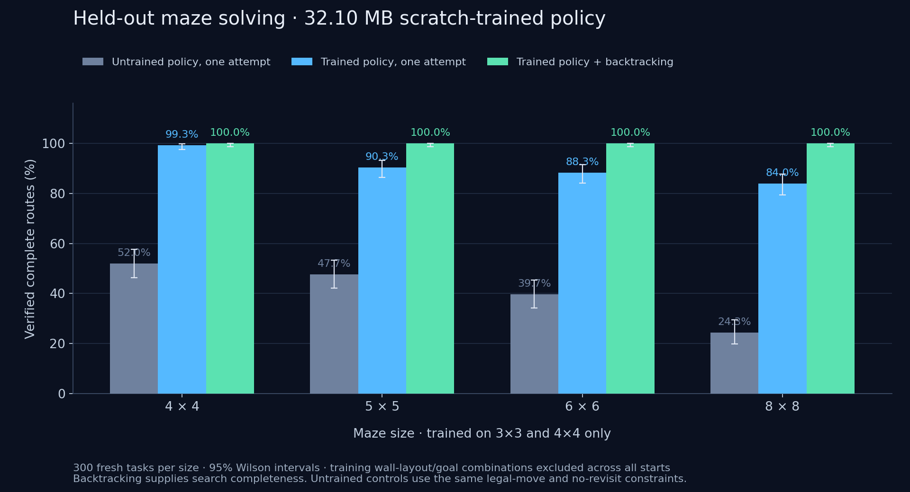

# Policy v1: measured results

**Local CPU maze solver: ready within the tested scope.** The model alone remains imperfect. The hybrid combines learned priorities with explicit bounded backtracking; it is not a general reasoning model.

The released model is 8,024,004 parameters, 32,099,618 bytes of FP32 weights. It was trained from random initialization for 1,500 steps on 3,000 synthetic 3x3/4x4 mazes, covering 27,392 reachable decision states.

## Primary held-out results

300 unique tasks per size, three evaluation seeds: 1,200 total. Training wall-layout/goal combinations are excluded **regardless of start position**, and test tasks are deduplicated by the same identity. These are fresh final seeds after development.

| Maze | Untrained, one attempt | Trained, one attempt | Trained, up to four attempts | Trained + backtracking | Exact BFS |
|---|---:|---:|---:|---:|---:|
| 4x4 | 52.0% | 99.3% | 99.7% | 100.0% | 100.0% |
| 5x5 | 47.7% | 90.3% | 96.0% | 100.0% | 100.0% |
| 6x6 | 39.7% | 88.3% | 94.7% | 100.0% | 100.0% |
| 8x8 | 24.3% | 84.0% | 92.3% | 100.0% | 100.0% |

Four-attempt policy mode is resampling, not learned textual feedback: feedback and no-feedback scores match. Both trained and untrained rollouts mask illegal moves and avoid revisits. The untrained greedy comparison therefore controls for these supplied constraints.

The primary neural-only aggregate was 1,086/1,200 (90.5%); guided search was 1,200/1,200, with Wilson 95% interval 99.68–100%. Search with an untrained policy also solved all cases: the algorithm supplies completeness. Learned ordering reduces expansions and improves neural-only routes. The guided routes were optimal on 86.2% of tasks; the search is depth-first, not an optimal-route guarantee. BFS was optimal on all tasks and is the practical exact baseline.



## Independent training repetitions

All three runs used the same recipe with independent initialization/data seeds; the primary run has 1,200 final cases, repetitions have 270 each on distinct held-out corpora. These are not paired evaluations of identical tasks.

| Training seed | Final test cases | 4x4 greedy | 6x6 greedy | 8x8 greedy | Hybrid verified | Local solver gates |
|---|---:|---:|---:|---:|---:|---|
| 314 | 1200 | 99.3% | 88.3% | 84.0% | 1200/1200 | PASS |
| 315 | 270 | 94.4% | 88.9% | 78.9% | 270/270 | PASS |
| 316 | 270 | 96.7% | 83.3% | 86.7% | 270/270 | PASS |

**Across the three final runs: 1,740/1,740 hybrid solutions verified.** This does not establish universal accuracy outside these finite task sets.

## Learned contribution and resources

| Size | Trained mean search states | Untrained mean search states | Greedy improvement over untrained, 95% paired-bootstrap interval |
|---|---:|---:|---|
| 4x4 | 3.74 | 7.16 | +47.3 percentage points [41.7, 53.0] |
| 5x5 | 5.37 | 10.60 | +42.7 percentage points [36.3, 49.0] |
| 6x6 | 6.76 | 15.15 | +48.7 percentage points [42.3, 54.7] |
| 8x8 | 8.94 | 25.85 | +59.7 percentage points [53.3, 65.7] |

Primary guided latency: p50 9.6 ms, p95 31.8 ms on two CPU threads. Shared CPU load was uncontrolled. Peak RSS 340.9 MB includes the entire benchmark process and two models; it is not isolated model or training memory. No CUDA measurement is available.

Held-out expert next-decision accuracy: 97/100; NLL 0.3153. Eighteen duplicate/training-layout candidates were skipped to obtain the final 100 held-out examples. This metric is separate from whole-route success.

## Correctness, robustness and evidence

- Twelve tests passed: independent verifier audit, causality/answer masking for the legacy decoder, trainability, both checkpoint resume paths, export/reload, policy/search bounds, feature dimensions, malformed UI inputs, canonical holdout identity, overlap skipping and real HTTP modes.
- The verifier audit enumerated all 48 two-by-two layouts and 16,512 path cases against an independent simulation.
- The fixed forced-detour and 8x8 corridor were solved by the neural policy in the recorded demonstrations. The corridor needs 35 moves. Two easy stress fixtures overlap training layout/goal combinations and are labeled accordingly; they are not held-out accuracy evidence.
- Impossible tasks return no verified solution within the bounded search. This is algorithmic exhaustion, not learned impossibility recognition.
- The complete updated notebook executed locally with tiny/CPU overrides, including training, evaluation, both solve modes and a 90-case benchmark. Remote Colab/GPU was not run.
- Actual browser screenshots, recording and API responses are in [evidence](../evidence/README.md). The screen recording is 12.68 seconds of real browser interactions; route animation is playback after verification.

## Acceptance scope

The local solver gates require valid model size, verifier audit, leak exclusion, all final hybrid tasks and reachable stress fixtures solved within budget, rejection of an impossible maze, neural greedy success at least the existing 80% ID / 60% larger-maze targets, and fewer mean expanded states than untrained ordering. All three final models pass.

The original `ready` research flag remains false: it requires a demonstrated learned textual-feedback benefit and GPU measurements, which this policy does not provide. `local_hybrid_solver_ready` is the applicable readiness flag. Local gates were strengthened during final report postprocessing using the recorded greedy quality and expansion counts; no cases or inference results were changed.

Remaining limitations: finite synthetic maze scope, imperfect model-only routes, non-optimal DFS paths, CPU-only validation, and no real Colab disconnect recovery. No general language reasoning, multimodal capability or superiority to BFS is claimed.

## Reproduce / inspect

```bash
python -m unittest discover -s tests -v
sys2 benchmark --run artifacts/policy-v1 --output runs/reproduce-policy-v1 \
  --count 100 --sizes 4 5 6 8 --seeds 37000000 38000000 39000000 \
  --attempts 4 --temperature 0.8 --require-local-solver
```

- [Primary report](policy-v1/primary/report.json), [raw routes and search traces](policy-v1/primary/records.jsonl), [frozen cases](policy-v1/primary/cases.json).
- [Untrained greedy control, including every raw route](policy-v1/untrained-greedy-control.json).
- [Seed 315](policy-v1/seed315/report.json) and [seed 316](policy-v1/seed316/report.json).
- [Test output](policy-v1/tests.txt).

Earlier policy evaluation passes were superseded when the all-starts holdout requirement was identified; they are not the final scores presented here. Current source also includes untrained-greedy directly in the benchmark command; the final runs saved here measured that control in a separate pass over the identical frozen corpus.
